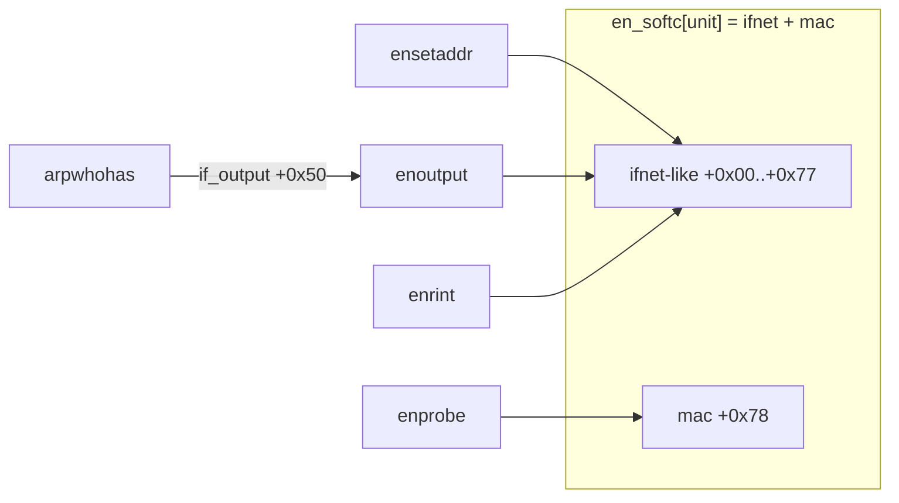
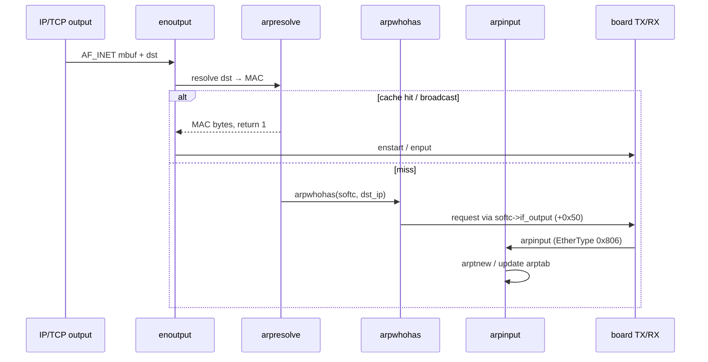

# WIN/3B softc + TWG TCP/IP notes (`ether.o`)

Follow-on to the board datapath in [`unixpc_hw.md`](unixpc_hw.md) and the
Ghidra setup in [`ghidra-mcp-ether.md`](ghidra-mcp-ether.md).

**Primary artifact now:** linked image from `scripts/link-ether-coff.py`
→ `re/binaries/ether.linked.bin` (+ `.map.json`), imported in Ghidra as
`ether.linked.bin` at base `0x367000` with R_RELLONG applied. Decomp
resolves `NextCSR`, `StatusRing`, `RxRing`, `en_softc`, `ipintrq`,
`arptab`, etc. Kernel externals (`getslot`, `bcopy`, …) remain `0` /
`func_0x00000000`.

**Do not redo** the status-ring / AM7990 board path unless something
disagrees with MAME.

---

## Address model

| Space | Meaning |
|-------|---------|
| **Linked image (preferred)** | `.text` @ `0x367000`, then `.data`, `.bss`, then COMMON. Built by `link-ether-coff.py`. Length padded to `0x13000` (ifile). |
| **Raw `.o` flat (legacy)** | Whole COFF file at `0x367000` including headers; no relocs. Use only for COFF forensics. |
| **COFF link VMA** | Relocatable object: `.text @ 0x80000`, `.data @ 0x90000`, `.bss @ 0x91054`. Reloc type **17** = `R_RELLONG`. |

### Linked COMMON vs `unixpc_hw.md` table

Commons land in symbol-table order after `.bss`. Matches the hw softc
cluster within ~4 bytes (likely one alignment/ordering difference vs the
live `lddrv` load Capstone used):

| Symbol | Linked VA | Hw table (approx) |
|--------|-----------|-------------------|
| `RxRing` | `0x3795d4` | `0x3795d0` |
| `TxRing` | `0x3795d8` | `0x3795d4` |
| `NxtRBuf` | `0x3795dc` | `0x3795d8` |
| `InitBlock` | `0x3795f8` | `0x3795f4` |
| `dap` / `rap` / `control_addr` / `status_ring_addr` | `0x379610`…`61c` | `0x37960c`…`618` |
| `enetaddr` | `0x379630` | `0x379628` / `62c` region |
| `StatusRing` | `0x379648` | `0x379644` |
| `NextCSR` | `0x37964c` | `0x379648` |
| `en_softc` | `0x379654` | `0x379650` |
| `arptab` | `0x3789e4` | (COMMON; size `0x5f0`) |
| `ipintrq` | `0x379050` | (COMMON; size `0x14`) |

`enprobe` fills MMIO pointer commons from `getslot(0x1003)` window:
`dap`, `rap=+2`, `control_addr=+4`, `status_ring_addr=+6`,
`reset_addr=+0x3FFF8`, `node_addr=+0x3FFCA`, copies odd MAC bytes into
`enetaddr` and `softc+0x78`.

### Rebuild / re-import

```bash
~/Projects/unixpc-lab/scripts/link-ether-coff.py
# GhidraMCP: POST /import_file language=68000:BE:32:default
#            POST /set_image_base 0x367000  (once; program was at 0)
# Label from ether.linked.map.json; recreate en_softc + arptab_entry
```

Pass `program=ether.linked.bin` on every MCP call when `ether.o` is also open.

---

## `en_softc` (stride `0x7e`)

Size `0x7e` = classic TWG `ifnet` (`0x78`, cf. COMMON `loif`) **plus** a
trailing 6-byte station MAC at `+0x78`. Unit `u` → `en_softc + u*0x7e`.

Callers pass the unit (`enprobe` / `eninit` / `enrint` / `enstart`) or an
`ifnet*` whose `if_unit` at `+4` indexes softc (`enoutput`).

| Off | Field | Evidence |
|-----|-------|----------|
| `+0x00`…`+0x07` | `ifnet` head (name/unit/…) | Not yet field-named; `enoutput` reads `if_unit` at `ifnet+4` when passed an `ifnet*` |
| `+0x08` | `in_netof` | `ensetaddr` |
| `+0x0c` | `if_flags` (word); `+0xd` byte tests | `eninit` `\| 0x41`; `arpinput` / `arpresolve` test `+0xd & 0x80` |
| `+0x10` | `in_lnaof` | `ensetaddr` |
| `+0x18`…`+0x24` | `ifreq` / sockaddr words | `ensetaddr` |
| `+0x1c` | configured IPv4 (also ARP local) | `eninit` gate; `arpinput` / `arpwhohas` |
| `+0x28` | `sa_family` (`2` = `AF_INET`) | `ensetaddr` |
| `+0x2c` | broadcast | `ensetaddr` |
| `+0x38` | output mbuf queue **head** | `enoutput` / `enstart` |
| `+0x3c` | output queue **tail** | |
| `+0x40` | output queue length | |
| `+0x44` | output queue max | |
| `+0x48` | output drops | |
| `+0x50` | `if_output` | `arpwhohas` → `(*(softc+0x50))(…)` (typically `enoutput`) |
| `+0x60` | RX interrupt count | `enrint` (`en_softc+0x60` → `0x3796b4` linked) |
| `+0x64` | RX error count | `enrint` / ENP miss |
| `+0x78`…`+0x7d` | station MAC | `enprobe` / TX src / ARP |

Ghidra: datatype `en_softc` applied at linked `0x379654`.



---

## `arptab` entry (size `0x10`, bucket `0x50` = 5 slots)

From `arpresolve` / `arpinput` on the linked image:

| Off | Field | Notes |
|-----|-------|-------|
| `+0x00` | `at_iaddr` | IPv4 |
| `+0x04` | `at_enaddr[6]` | MAC |
| `+0x0a` | `at_hold` | held `mbuf*` while resolving |
| `+0x0e` | `at_timer` | age |
| `+0x0f` | `at_flags` | bit `2` = complete |

Hash bucket: `arptab + hash*0x50`, linear probe 5 entries (`int*` step `+4`
= 16 bytes). Ghidra: `arptab_entry` / `arptab_bucket` at `0x3789e4`.

---

## TWG path: Ethernet RX → ARP / IP → TCP

Board side (`unixpc_hw.md`): status-ring high byte `0x04` → `enintr` →
`enrint`.

### `enintr` (linked `0x374f16`)

Drains `*NextCSR` until `0xFFFF`, wraps at `StatusRing + 0x100`, strips
error-shaped words, matches high byte:

- `0x0100` IDON — continue
- `0x0200` TINT — reclaim via `INxtTBuf` / TX ring
- `0x0400` RINT — `enrint(0)`
- else — `"Bad CSR on interrupt"` → `enreset`

### `enrint` demux (linked `0x3751ac`)

1. Walk RX descriptors (`NxtRBuf` / `RxRing` / `nBufs`); `enget` → mbuf + EtherType.
2. Return descriptor to chip (`OWN`).
3. EtherType:
   - **`0x0800`:** enqueue on `ipintrq`, set netisr bit `4`, schedule softnet.
   - **`0x0806`:** `arpinput(&en_softc + unit, m)` (JSR abs → `0x36e0f4`).
   - **else:** `m_freem`.
4. Missing ENP → `"RX_ENP not found"` / `-1` → `enreset`.

### ARP



- `arpresolve` `0x36df5a` — broadcast → `etherbroadcastaddr`; else hash
  `arptab`; miss → `arptnew` + `arpwhohas`, return 0.
- `arpwhohas` `0x36de66` — 28-byte ARP request, type `0x806`, MAC from
  `softc+0x78`, IP from `softc+0x1c`.
- `arpinput` `0x36e0f4` — learn/update; reply when target IP matches
  `softc+0x1c`.

### IP → TCP

Softnet drains `ipintrq` → `ipintr` (`0x36f776`) → `inetsw` /
`ip_protox` → `tcp_input` (`0x370d80`). Treat TCP as stock TWG/BSD when
debugging telnet; prefer `enrint` / ARP / `enoutput` for board wedges.

### TX join

`enoutput` (`0x3753bc`): `AF_INET` → `arpresolve`, 14-byte Ethernet
header, softc outq, `enstart` → `enput` → LANCE TX (`OWN|STP|ENP`).

---

## Ghidra labels (linked image)

| Symbol | Linked VA |
|--------|-----------|
| `enprobe` | `0x3747f0` |
| `enintr` | `0x374f16` |
| `enrint` | `0x3751ac` |
| `enoutput` | `0x3753bc` |
| `setreg` | `0x375a48` |
| `arpwhohas` | `0x36de66` |
| `arpresolve` | `0x36df5a` |
| `arpinput` | `0x36e0f4` |
| `ipintr` | `0x36f776` |
| `tcp_input` | `0x370d80` |
| `tcp_output` | `0x371fe0` |

Raw-`.o` flat VAs in older notes differ (COFF header skew); prefer this
table.

---

## Still open

- Name `en_softc+0x00…+0x07` against a TWG `ifnet` header dump.
- Wire externals (`getslot`, `bcopy`, `copyin`, …) as EXTERNAL stubs or
  against `/unix` for full call graphs.
- Optional live MAME ARP/telnet counter check vs `enrint` demux.
