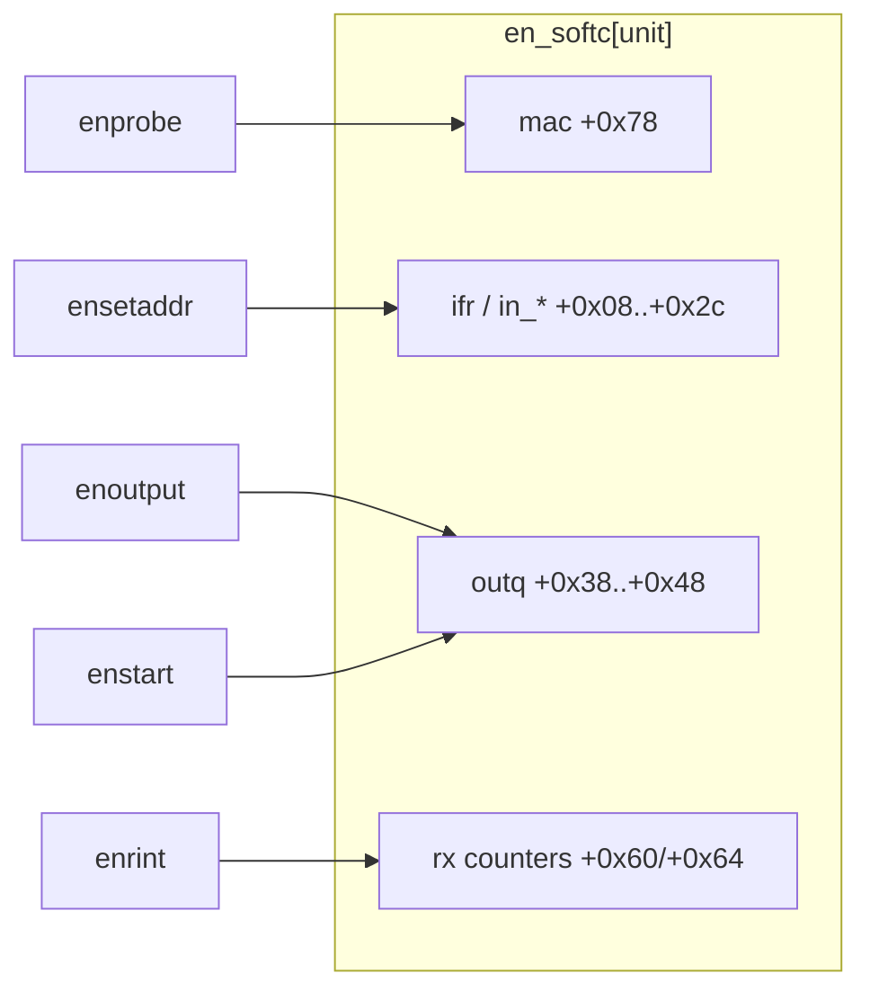
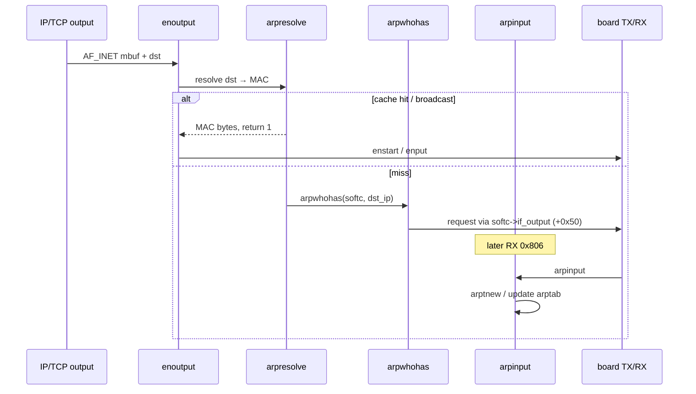

# WIN/3B softc + TWG TCP/IP notes (`ether.o`)

Follow-on to the board datapath in [`unixpc_hw.md`](unixpc_hw.md) and the
Ghidra setup in [`ghidra-mcp-ether.md`](ghidra-mcp-ether.md). Sourced from
GhidraMCP headless decomp of 3.51 `ether.o` with COFF symbols applied
(BinaryLoader flat at `0x367000`). Relocations are **not** applied, so many
callees still show as `func_0x…` / `_SUB_00000000`; named entry points and
struct **offsets** are trustworthy.

**Do not redo** the status-ring / AM7990 board path unless something
disagrees with MAME. This doc is the softc layout and one TWG path.

---

## Address model

| Space | Meaning |
|-------|---------|
| **Ghidra flat VA** | Whole COFF file at `0x367000` (headers included). `.text` bytes at `0x367400+`. Map: `BASE + scnptr + (n_value − sect.vaddr)`. |
| **COFF link VMA** | Relocatable object: `.text @ 0x80000`, `.data @ 0x90000`, `.bss @ 0x91054`. |
| **Guest runtime** | `lddrv` ALLOC ~`0x367000` (see `ifile.ether` / `unixpc_hw.md`). Commons (`en_softc`, `NextCSR`, ring pointers) land in the loaded image; absolute addrs in the hw softc table are **one** load’s VAs, not Ghidra flat VAs. |

`en_softc` / `NextCSR` / `enetvaddr` appear in the COFF as **undefined
commons** (`scnum=0`) with sizes (`en_softc` value `0x7e` = stride). They
are not `.data` labels inside the `.o`.

Named `.data` globals (Ghidra flat):

| Symbol | Flat VA | Role |
|--------|---------|------|
| `nBufs` | `0x37805a` | descriptor count (`0x20`) |
| `BufferSize` | `0x378056` | buffer bytes (`0x80`) |
| `enetdrv` | `0x37804e` | `configure` / driver table |
| `intr_enabled` | `0x37805e` | IRQ armed flag (hw `0x377b1a` is a different load map) |
| `doenprintfs` | `0x3780c6` | debug printf gate |
| `etherbroadcastaddr` | `0x377798` | `ff:ff:ff:ff:ff:ff` |
| `arptab_size` | `0x377794` | ARP hash size |
| `inetsw` / `inetdomain` | `0x377874` / `0x377950` | TWG `protosw` / domain |

---

## `en_softc` (stride `0x7e`)

Unit `u` uses base `en_softc + u*0x7e`. Callers either pass the unit
(`enprobe` / `eninit` / `enrint` / `enstart`) or an `ifnet*` whose
`if_unit` at `+4` indexes softc (`enoutput`).

Offsets confirmed from decomp:

| Off | Field | Evidence |
|-----|-------|----------|
| `+0x08` | `in_netof` | `ensetaddr` |
| `+0x0c` | `if_flags` (word); `+0xd` byte tests | `eninit` `\| 0x41` (`IFF_UP\|IFF_RUNNING`); `arpinput` tests `+0xd & 0x80` |
| `+0x10` | `in_lnaof` | `ensetaddr` |
| `+0x18`…`+0x24` | `ifreq` / sockaddr words | `ensetaddr` copy |
| `+0x1c` | “address configured” (non-zero) | `eninit` gate; also local IP for ARP |
| `+0x28` | `sa_family` (`2` = `AF_INET`) | `ensetaddr` |
| `+0x2c` | broadcast | `ensetaddr` / `if_makeaddr` |
| `+0x38` | output mbuf queue **head** | `enoutput` / `enstart` |
| `+0x3c` | output queue **tail** | |
| `+0x40` | output queue length | |
| `+0x44` | output queue max | enqueue vs drop |
| `+0x48` | output drops | |
| `+0x50` | `if_output`-style function pointer | `arpwhohas` calls `(*(softc+0x50))(…)` |
| `+0x60` | RX interrupt count | `enrint` |
| `+0x64` | RX error count | `enrint` / ENP miss |
| `+0x78`…`+0x7d` | station MAC (6 bytes) | `enprobe` / `enoutput` src / ARP |

Ghidra datatype: `en_softc` (size `0x7e`), field names Hungarian-prefixed
by the MCP naming gate (`dwIn_netof`, `aMac`, …). Apply at a runtime
softc base when analyzing a linked dump; on the flat `.o` the COMMON is
not materialized.

Board MMIO pointers (RDP/RAP/CTL/status port, `NextCSR`, DMA arena,
InitBlock, RX/TX rings) are separate globals described in
`unixpc_hw.md` — filled by `enprobe`/`eninit`, not fields of this
`0x7e` softc blob.

---

## TWG path: Ethernet RX → ARP / IP → TCP

Board side (already in `unixpc_hw.md`): status-ring high byte `0x04`
→ `enintr` → `enrint`.

### `enrint` demux (flat `0x3755ac`)

1. Walk RX descriptors until `OWN` clear; read MCNT; `enget` → mbuf +
   EtherType in `local_16`.
2. Return descriptor to chip (`OWN|0x8000`).
3. EtherType:
   - **`0x0800` (IP):** enqueue on `ipintrq` (COMMON), bump length, set
     netisr bit (`\| 4`) and `func(…, 0x84b54, 0, 1)` soft-net schedule.
     If queue full, increment drop counter and free later.
   - **`0x0806` (ARP):** `arpinput(softc, mbuf)` at flat `0x36e4f4`.
   - **else:** `m_freem`-style free (`func_0x00086796`).
4. Missing ENP / bad length → `"RX_ENP not found"` / error counters →
   often `-1` so `enintr` calls `enreset`.

### ARP (`arpresolve` / `arpwhohas` / `arpinput`)

- `arpresolve` (`0x36e35a`): broadcast → copy `etherbroadcastaddr`; else
  hash-probe `arptab` (bucket stride `0x50`, 5 slots); on miss `arptnew` +
  `arpwhohas` and return 0 (packet held on `arptab` entry `+0xa`).
- `arpwhohas` (`0x36e266`): build 28-byte ARP request, EtherType `0x806`,
  sender MAC from `softc+0x78`, sender IP from `softc+0x1c`, output via
  `softc+0x50`.
- `arpinput` (`0x36e4f4`): ignore if `softc+0xd & 0x80`; learn/update
  table; reply path when target IP matches `softc+0x1c`.

### IP → TCP (entry only)

- Softnet drains `ipintrq` into `ipintr` (`0x36fb76`) → protocol switch
  (`inetsw` / `ip_protox`) → `tcp_input` (`0x371180`) for TCP.
- `tcp_input` is large BSD-style (checksum gate via `tcpcksum`, options,
  `tcp_reass`, `tcp_dooptions`). Treat as stock TWG/BSD; prefer
  `arpresolve`/`enoutput` when debugging guest telnet TX, and
  `enrint`/`arpinput`/`ipintr` when debugging RX wedges.

### TX join (board again)

`enoutput` (`0x3757bc`): non-INET raw path copies 6-byte dst; `AF_INET`
calls `arpresolve`, prepends 14-byte Ethernet header (dst/src from
`softc+0x78`/type), enqueues on softc outq, `enstart` → `enput` → LANCE
TX ring (`OWN|STP|ENP`).

---

## Ghidra labels (this project)

Board: `enprobe` `0x374bf0`, `enintr` `0x375316`, `enrint` `0x3755ac`,
`enoutput` `0x3757bc`, `setreg` `0x375e48`, …

TWG sample: `arpwhohas` `0x36e266`, `arpresolve` `0x36e35a`, `arpinput`
`0x36e4f4`, `ipintr` `0x36fb76`, `tcp_input` `0x371180`, `tcp_output`
`0x3723e0`.

Re-apply: `scripts/ghidra-label-ether-coff.py --all-twg` plus the ARP/IP
batch used when writing this note (same COFF map).

---

## Still open

- Materialize COMMON/BSS (`en_softc`, `NextCSR`, rings) in Ghidra or
  re-import a **linked** `ifile.ether` dump so runtime VAs match
  `unixpc_hw.md` softc table 1:1.
- Apply COFF relocations (2133 `.text` relocs) so decomp stops using
  `func_0x00000000`.
- Softc fields `+0x00…+0x07`, `+0x50` exact type, and full `arptab`
  entry layout.
- One live MAME trace: ARP request/reply counters vs `enrint` demux
  (optional; board path already verified for telnet).
